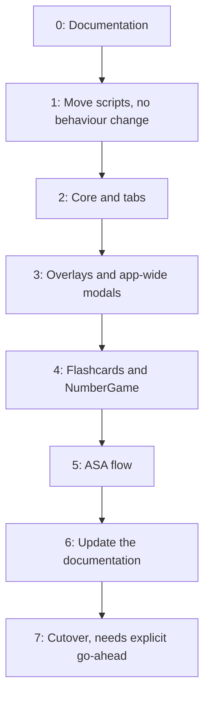

# Navigation Migration

How the app moves from the old panels to the new navigation system.

> **Status: ready for final checks.** Stages 1 to 5 have passed in Unity, with server paths
> tested against the fake server only. `MainScene` and the original scripts stay untouched until
> cutover.

| Stage                  | Code     | Scene work | Play mode check                 |
| ---------------------- | -------- | ---------- | ------------------------------- |
| 0: Documentation       | Done     | –          | –                               |
| 1: Move scripts        | Done     | Done       | Passed, against the fake server |
| 2: Core and tabs       | Done     | Done       | Passed                          |
| 3: Overlays and modals | Done     | None       | Passed                          |
| 4: Flashcards, NumberGame | Done  | Done       | Passed                          |
| 5: ASA flow            | Done     | Done       | Passed                          |
| Freestyle code wiring  | Done     | None       | Not run                         |
| 6: Update the documentation | Done | –         | –                               |
| 7: Cutover             | Waiting for go-ahead | – | –                            |

## Approach

The new system is built in `TESTING_SCENE`, with its scripts in
`Assets/Scripts/NewScripts/`. The old and new scripts compile side by side, and the old
ones keep running in `MainScene`, which remains the only build scene. Avoid feature work
in the old scripts and `MainScene` until cutover, or the changes must be copied across by
hand.

## Stages

Each stage ends with a Play mode check. When a button migrates, `ButtonWiring.Replace` turns
off its Inspector `OnClick` entries while the app runs, so they don't need clearing by hand.

## Hierarchy

Opening a `Screen` layer entry hides the tab root, which would also hide its children, so pushed
screens are siblings of the tab roots. `Navigator` logs an error naming any that aren't. Popups
stay under their owners in the scene, because `ModalScreen.Attach` lifts them while the app runs.
The order is in [Wiring](WIRING.md#hierarchy).

Two kinds of object are no longer used and can be deleted to tidy up: `Manager/PopUpManager`,
which `Navigator` disables at launch, and the five old `DimPanel` objects.

## Stage 1 scene update

Copying a script gives it a new GUID, so `TESTING_SCENE` has to point at the copies. A
one-off script rewrites two things in the scene file, which preserves every Inspector value:

- The old script GUIDs become the new ones (18 references).
- `m_TargetAssemblyTypeName` values become the new class names (48 references). Four of
  these are the tab buttons, which still name a `Navigation` class from before
  `NavigationBar`.

Commit `TESTING_SCENE` first, because it is untracked and the rewrite could not otherwise
be undone.

Fields named after their own type, such as `ASAPanel ASAPanel`, would have lost their scene
value when renamed, so the copies carried `[FormerlySerializedAs]` until those fields moved to
code. `m_EditorClassIdentifier` values are left alone: scripts are matched by GUID, and Unity
rewrites these values when it saves the scene.

## Checks waiting on the backend

These need a server. Use the [fake server](FAKE_SERVER.md) to check them during each stage,
then run them against the real backend before cutover, because the fake server can't prove
what the real one sends:

- **Pronunciation:** a score appears in Freestyle and on a flashcard, including the warning icon.
- **Number game:** a result appears.
- **ASA:** onboarding creates a user, a send reaches results, and the loading title moves to
  completed. Repeat with a second task.
- **Profile:** opens with stats, retries after a failure, and reloads after a level change.
- **Survey:** appears on every 50th successful recording.
- **Account deletion:** confirmed by the server, then the onboarding gate runs again.

## Class mapping

| Old                           | New                      | Layer    |
| ----------------------------- | ------------------------ | -------- |
| `MainPanel`                   | `FreestyleScreen`        | Tab root |
| `CardDeckPanel`               | `FlashcardsScreen`       | Tab root |
| `AdvancePanel`                | `AdvancedScreen`         | Tab root |
| `ProfilePanel`                | `ProgressScreen`         | Tab root |
| `SuperMemoPanel`              | `FlashcardSessionScreen` | Screen   |
| `NumberGamePanel`             | `NumberGameScreen`       | Screen   |
| `TaskPanel`                   | `ASATaskListScreen`      | Screen   |
| `ASAPanel`                    | `ASATaskScreen`          | Screen   |
| `FeedbackPanel`               | `ASAResultsScreen`       | Screen   |
| `ASAProfilePanel`             | `ASAProfileScreen`       | Screen   |
| `DetailScorePanel`            | `ScoreDetailScreen`      | Overlay  |
| `PhonemePanel`                | `PhonemeScreen`          | Overlay  |
| `InfoPanel`                   | `InfoScreen`             | Overlay  |
| `SurveyPopUpPanel`            | `SurveyModal`            | Modal    |
| `SecretPopUpPanel`            | `SecretModal`            | Modal    |
| `PopUpManager` + `PopUpPanel` | `InstructionModal`       | Modal    |
| `NavigationBar`               | `TabBar`                 | –        |
| `NetworkManager`              | `NetworkManager` (copy)  | –        |
| `AudioManager`                | `AudioManager` (copy)    | –        |
| `FeedbackAutoSend`            | `FeedbackAutoSend` (copy) | –       |

These scripts all move together because they depend on each other. For example, the old
`NetworkManager` holds fields typed to four panels, and several panels call
`NetworkManager.GetManager()`. `AudioManager` and `FeedbackAutoSend` move because their
code calls `NetworkManager`, which would otherwise resolve to the old class.

## NetworkManager UI removal

The copy's Inspector fields, UI types and screen references are gone, and the screens took
over that work. The new supporting classes are:

| Class                | Role                                                           |
| -------------------- | -------------------------------------------------------------- |
| `ServerError`        | Status code and server wording from a failed request           |
| `ServerNotices`      | Localized request text, defined in code from the same table entries |
| `BackgroundFormData` | Moved out of `AdvancedScreen` so `NetworkManager` needs no screen type |

See [Network responses](NAVIGATION.md#network-responses).

## Behaviour changes

- **Back:** one press closes exactly one layer. Today several handlers can fire together.
- **Tab roots:** back goes to Freestyle, then exits the app. Today it does nothing.
- **New Task:** the old task screen no longer stays active under the task list. As a
  result, `ASATaskScreen.OnEnable` now runs for each task.
- **Back in the ASA flow:** back now works on the task list and profile, and closes their
  popups. It waits for requests in progress.
- **Back on results:** returns to the task list. It is ignored today.
- **Back while recording a task:** stops the recording, and the next press leaves. Today the
  press does nothing.
- **Popups:** draw above the tab bar with one shared dim. The profile's loading popup, which
  appeared to draw behind the profile during a level change, now draws above it.
- **Error banners on the task list:** sit about 75 units lower, matching the profile's.
- **Spinner:** rotates during a level change, because it now lives on the loading popup.
- **Consent and Background popups:** can be closed with back, except while the form is sending.
  Consent behaves like Refuse.
- **Re-tapping a tab** on its root does nothing. Today it re-runs the panel's lifecycle.
- **Hidden screens:** a screen below a `Screen` layer entry is now disabled, so its
  `OnEnable` runs again on return. Today `CardDeckPanel` and others stay active.
- **Tab bar:** can no longer be tapped through a modal.
- **First-run popup on Freestyle:** should appear at cold start. Today it appears to be
  hidden by `PopUpManager.Start`.
- **Recording:** leaving Freestyle, a flashcard session or NumberGame cancels any recording,
  matching what `ASAPanel.OnDisable` already does.
- **Finished decks:** a long press that leaves nothing to study no longer opens the session.
- **`OnDisable` timing:** runs when the transition ends, up to 250 ms after navigating.
- **Listeners:** Advanced's main buttons no longer stack listeners in `OnEnable`, so one Send
  tap posts the onboarding form once.
- **Profile retry:** after a failed profile request, retrying shows the spinner and hides the
  back button. Today the spinner stays hidden and the back button stays visible.
- **Level change:** the spinner now rotates while the level is sent and the profile reloads.
- **Number game failure:** reports through its callback and logs an error, instead of throwing
  inside the coroutine. The learner sees the same message.

## Known gaps carried over

These match the old code and were left as they were:

- **`emptyTranscriptNotice`:** has no table entry, so a blank transcript shows nothing. It needs an
  entry adding to the table to give it wording.
- **Onboarding gate:** consent missing with the form marked complete has no branch, so the ASA
  button does nothing in that state.
- **Instruction popup:** one reusable popup with no queue, so the last caller wins.
- **User behaviour events:** still not called from the screens. See
  [the wiring notes](USER_BEHAVIOUR.md#wiring).

## Cutover

This happens only on explicit go-ahead:

1. Restore the real values in `Secret.cs`, which may still point at the fake server. Run the
   [backend checks](#checks-waiting-on-the-backend) against the real server, and test on an Android
   device, including back, recording, transitions and exiting the app.
2. Make `TESTING_SCENE` the build scene, or port it to `MainScene`.
3. Delete the old scripts and move the contents of `NewScripts` as needed. Remove the
   `PopUpManager` lines from `Navigator.Awake` at the same time.
4. Merge `docs/NEW/` with `docs/`, including replacing `docs/USER_BEHAVIOUR.md` with its
   updated copy.
5. Update this file.
