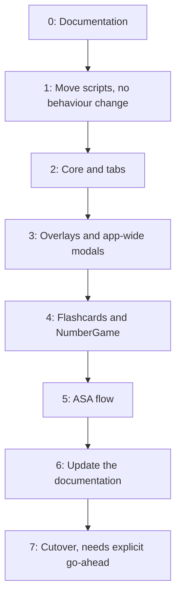

# Navigation Migration

How the app moves from the old panels to the new navigation system.

> **Status: in progress.** Code for Stages 1 to 3 is written and compiles. The hierarchy move
> is still to do. `MainScene` and the original scripts stay untouched until cutover.

| Stage                  | Code     | Scene work                         | Play mode check |
| ---------------------- | -------- | ---------------------------------- | --------------- |
| 0: Documentation       | Done     | –                                  | –               |
| 1: Move scripts        | Done     | Done                               | Passed, against the fake server |
| 2: Core and tabs       | Done     | Done                               | Passed          |
| 3: Overlays and modals | Done     | None required                      | Passed          |
| 4: Flashcards, NumberGame | Not started | Sub-screens must leave their tab roots | –     |
| 5: ASA flow            | Not started | Sub-screens must leave their tab roots | –        |

## Approach

The new system is built in `TESTING_SCENE`, with its scripts in
`Assets/Scripts/NewScripts/`. The old and new scripts compile side by side, and the old
ones keep running in `MainScene`, which remains the only build scene. Avoid feature work
in the old scripts and `MainScene` until cutover, or the changes must be copied across by
hand.

## Stages

Each stage ends with a Play mode check. When a button migrates, `ButtonWiring.Replace` turns
off its Inspector `OnClick` entries while the app runs, so they don't need clearing by hand.

## Inspector fields still to move

`FreestyleScreen`, `FlashcardsScreen` and `AdvancedScreen` became `AppScreen`s in Stage 2 but
still use their Inspector fields. `AdvancedScreen` moves to code with the ASA flow in Stage 5,
and `FlashcardsScreen` with Stage 4. `FreestyleScreen` has no stage of its own yet, so it
needs a pass before cutover.

## Hierarchy

Stages 1 to 3 work with the current hierarchy, because tab roots, overlays and app-wide modals
are already siblings under the root Canvas. Its name doesn't matter to the code.

`Manager/PopUpManager` can be deleted from the scene. `Navigator` disables it at launch, so
this is only tidying.

Stages 4 and 5 need more. `SuperMemoPanel`, `NumberGamePanel` and the ASA screens are children
of tab roots, and pushing a `Screen` layer entry hides the tab root, which would hide its
children too. They must become siblings of the tab roots before those stages can be tested.

## Stage 1 scene update

Copying a script gives it a new GUID, so `TESTING_SCENE` has to point at the copies. A
one-off script rewrites two things in the scene file, which preserves every Inspector value:

- The old script GUIDs become the new ones (18 references).
- `m_TargetAssemblyTypeName` values become the new class names (48 references). Four of
  these are the tab buttons, which still name a `Navigation` class from before
  `NavigationBar`.

Commit `TESTING_SCENE` first, because it is untracked and the rewrite could not otherwise
be undone.

Fields named after their own type, such as `ASAPanel ASAPanel`, would lose their scene
value when renamed, so the copies carry `[FormerlySerializedAs]` until those fields are
removed in later stages. `m_EditorClassIdentifier` values are left alone: scripts are
matched by GUID, and Unity rewrites these values when it saves the scene.

## Checks waiting on the backend

These need a server. Use the [fake server](FAKE_SERVER.md) to check them during each stage,
then run them against the real backend before cutover, because the fake server can't prove
what the real one sends:

- **Pronunciation:** a score appears in Freestyle and on a flashcard, including the warning icon.
- **Number game:** a result appears.
- **ASA:** onboarding creates a user, a send reaches results, and the loading title moves to
  completed. Repeat with a second task.
- **Profile:** opens with stats, retries after a failure, and reloads after a level change.
- **Survey:** appears on every 50th successful recording.
- **Account deletion:** confirmed by the server, then the onboarding gate runs again.

## Class mapping

| Old                           | New                      | Layer    |
| ----------------------------- | ------------------------ | -------- |
| `MainPanel`                   | `FreestyleScreen`        | Tab root |
| `CardDeckPanel`               | `FlashcardsScreen`       | Tab root |
| `AdvancePanel`                | `AdvancedScreen`         | Tab root |
| `ProfilePanel`                | `ProgressScreen`         | Tab root |
| `SuperMemoPanel`              | `FlashcardSessionScreen` | Screen   |
| `NumberGamePanel`             | `NumberGameScreen`       | Screen   |
| `TaskPanel`                   | `ASATaskListScreen`      | Screen   |
| `ASAPanel`                    | `ASATaskScreen`          | Screen   |
| `FeedbackPanel`               | `ASAResultsScreen`       | Screen   |
| `ASAProfilePanel`             | `ASAProfileScreen`       | Screen   |
| `DetailScorePanel`            | `ScoreDetailScreen`      | Overlay  |
| `PhonemePanel`                | `PhonemeScreen`          | Overlay  |
| `InfoPanel`                   | `InfoScreen`             | Overlay  |
| `SurveyPopUpPanel`            | `SurveyModal`            | Modal    |
| `SecretPopUpPanel`            | `SecretModal`            | Modal    |
| `PopUpManager` + `PopUpPanel` | `InstructionModal`       | Modal    |
| `NavigationBar`               | `TabBar`                 | –        |
| `NetworkManager`              | `NetworkManager` (copy)  | –        |
| `AudioManager`                | `AudioManager` (copy)    | –        |
| `FeedbackAutoSend`            | `FeedbackAutoSend` (copy) | –       |

These scripts all move together because they depend on each other. For example, the old
`NetworkManager` holds fields typed to four panels, and several panels call
`NetworkManager.GetManager()`. `AudioManager` and `FeedbackAutoSend` move because their
code calls `NetworkManager`, which would otherwise resolve to the old class.

## NetworkManager UI removal

The copy's Inspector fields, UI types and screen references are gone, and the screens took
over that work. The new supporting classes are:

| Class                | Role                                                           |
| -------------------- | -------------------------------------------------------------- |
| `ServerError`        | Status code and server wording from a failed request           |
| `ServerNotices`      | Localized request text, defined in code from the same table entries |
| `BackgroundFormData` | Moved out of `AdvancedScreen` so `NetworkManager` needs no screen type |

The screens reuse the references they already had to these popups, so nothing new needs
assigning. `ASATaskScreen` finds the popup's `Title` by path. See
[Network responses](NAVIGATION.md#network-responses).

## Behaviour changes

- **Back:** one press closes exactly one layer. Today several handlers can fire together.
- **Tab roots:** back goes to Freestyle, then exits the app. Today it does nothing.
- **New Task:** the old task screen no longer stays active under the task list. As a
  result, `ASATaskScreen.OnEnable` now runs for each task.
- **Back in the ASA flow:** on the task list and profile, back now matches the on-screen back
  control, and waits for popups and requests in progress.
- **Back on results:** will return to the task list after Stage 5. Until then it does nothing,
  as it does today.
- **Consent and Background popups:** can be closed with back. Consent behaves like Refuse.
- **Re-tapping a tab** on its root will do nothing after Stage 5. Until then it re-runs the
  screen's lifecycle, as it does today.
- **Hidden screens:** a screen below a `Screen` layer entry is now disabled, so its
  `OnEnable` runs again on return. Today `CardDeckPanel` and others stay active.
- **Tab bar:** can no longer be tapped through a modal.
- **First-run popup on Freestyle:** should appear at cold start. Today it appears to be
  hidden by `PopUpManager.Start`.
- **Recording:** leaving Freestyle cancels any recording, matching what `ASAPanel.OnDisable`
  already does. Flashcard sessions and NumberGame follow in Stage 4.
- **`OnDisable` timing:** runs when the transition ends, up to 250 ms after navigating.
- **Listeners:** wired once in `Awake`, which ends the listener stacking in
  `AdvancePanel.OnEnable`.
- **Profile retry:** after a failed profile request, retrying shows the spinner and hides the
  back button. Today the spinner stays hidden and the back button stays visible.
- **Level change:** the spinner now rotates while the level is sent and the profile reloads.
- **Number game failure:** reports through its callback and logs an error, instead of throwing
  inside the coroutine. The learner sees the same message.

## Cutover

This happens only on explicit go-ahead:

1. Test on an Android device, including back, recording and transitions.
2. Make `TESTING_SCENE` the build scene, or port it to `MainScene`.
3. Delete the old scripts and move the contents of `NewScripts` as needed. Remove the
   `PopUpManager` lines from `Navigator.Awake` at the same time.
4. Merge `docs/NEW/` with `docs/`, including replacing `docs/USER_BEHAVIOUR.md` with its
   updated copy.
5. Update this file.
