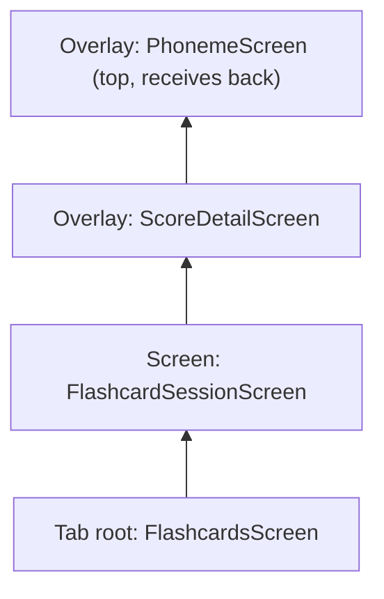
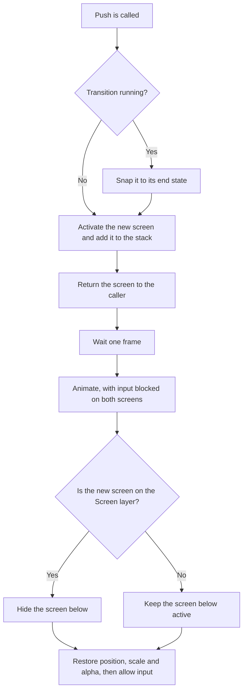
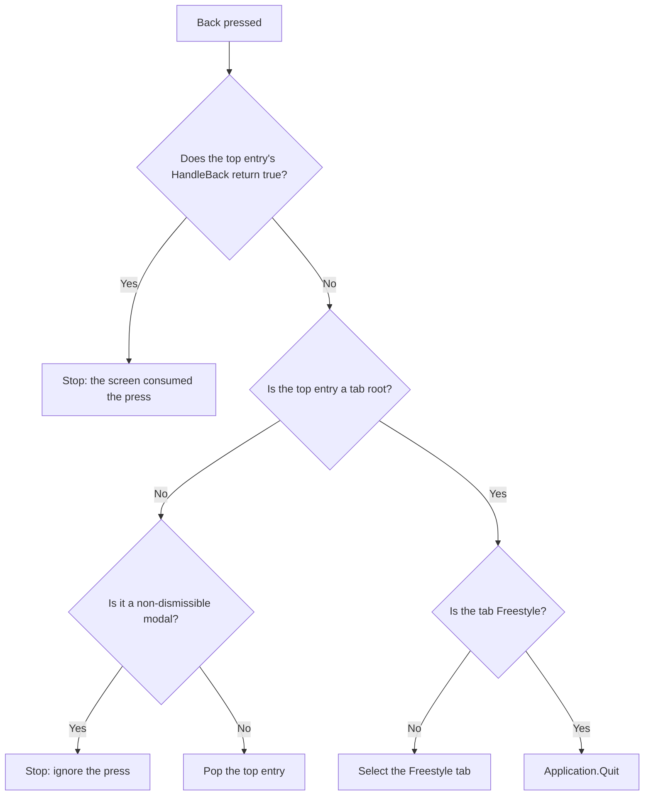

# Screen Navigation

How the app moves between screens, overlays and modals.

> **Status: in progress.** Tabs, overlays, app-wide modals, flashcard sessions and NumberGame
> are on the new system and have been run in Unity. The ASA flow joins in Stage 5, so parts of
> this describe the finished design.
> See [temporary behaviour](#temporary-behaviour).

Related: [Screens](SCREENS.md), [Transitions](TRANSITIONS.md), [Wiring](WIRING.md),
[Migration](MIGRATION.md).

## Overview

One class, `Navigator`, owns all navigation. Screens never switch each other on or off:
they ask `Navigator` to open a screen by type, and it handles history, back, visibility
and animation. Code lives in `Assets/Scripts/NewScripts/Navigation/`, in the
`SaySuomi.Navigation` namespace.

| Class               | Role                                                                   |
| ------------------- | ---------------------------------------------------------------------- |
| `Navigator`         | Owns the stack, the current tab and back handling. Created at launch.  |
| `AppScreen`         | Base class for every screen. Declares its layer and back behaviour.    |
| `ModalScreen`       | `AppScreen` for popups. Adds `Dismissible`.                            |
| `ModalHost`         | Presents modals: the shared dim and the modal animations.              |
| `ScreenTransitions` | The animation coroutines and their durations.                          |
| `TabBar`            | Tab buttons, icons and the new-feature dot. Follows `TabChanged`.      |

## Layers

Each screen declares its layer in code. Draw order comes from the hierarchy, so a higher
layer always covers a lower one.

| Layer     | Examples                       | The screen below                                | Covers the tab bar |
| --------- | ------------------------------ | ----------------------------------------------- | ------------------ |
| `Screen`  | Task list, flashcard session   | Hidden, and refreshed by its `OnEnable` on return | No               |
| `Overlay` | Score detail, phoneme, info    | Stays active, so its state stays in place       | Yes                |
| Modal     | Survey, consent, loading       | Stays active, behind the shared dim             | Yes                |

Screens are hidden with `SetActive`, not by disabling their Canvas. They rely on
`OnEnable` and `OnDisable` to load data, cancel recordings and remove listeners.

## The stack

The current tab root is always at the bottom. Everything opened from it sits above, and
the top entry receives back presses.



In this example, `FlashcardsScreen` is hidden because a `Screen` layer entry covers it.
`FlashcardSessionScreen` and `ScoreDetailScreen` stay active under their overlays.

## API

```csharp
T Push<T>() where T : AppScreen;   // returns the screen so the caller can give it data
T Open<T>() where T : ModalScreen;
void Open(ModalScreen modal);      // for popups with no class of their own
void Back();                       // the only Escape handler in the app
void PopTo<T>() where T : AppScreen;
void PopToRoot();
void SelectTab(AppScreen tabRoot); // clears the stack; no-op when already on that tab's root
event Action<AppScreen> TabChanged;
```

Data passes through typed methods on the returned screen, so there is no generic
arguments object:

```csharp
Navigator.GetManager().Push<ASATaskScreen>().DisplayTask(task);
```

The screen is active by the time `Push` returns, so its `OnEnable` has already run when
`DisplayTask` is called.

## Opening a screen



## Back

Only `Navigator` reads Escape, which is how Unity reports the Android back button. One
press therefore acts on exactly one layer.



Override `HandleBack` only when a screen must do something other than close. For example,
`ASATaskScreen` stops a running recording and returns true, so the first press stops the
recording and the next one leaves.

`Application.Quit` does nothing in the Editor, so exiting has to be tested on a device.

## Tabs

`SelectTab` clears the stack, then shows the chosen tab root. Returning to a tab therefore
always lands on its root. Once every screen has migrated, selecting the tab whose root is
already showing will do nothing.

`TabBar` updates from `TabChanged` rather than from its own button clicks, so its icons
stay correct when back selects Freestyle.

## Modals

`Navigator` keeps modals on the same stack as everything else, so back order stays in one
place. `ModalHost`, which `Navigator` adds to its own object, only handles how they are
presented:

- It creates one shared dim in code and keeps it directly below the top modal, in that
  modal's parent. The dim blocks input to everything beneath it, so a modal must draw above
  the tab bar for the dim to block the tabs.
- It runs the modal open and close animations.

`Dismissible` is false while a loading popup is waiting on the server, then true once it
shows an error, so back can leave a failed request but not one in progress.

## Startup and scenes

`Navigator` creates itself with `[RuntimeInitializeOnLoadMethod]`, as `UserEventManager`
does, and finds every `AppScreen` in the scene, including inactive ones. It then hides the
other tab roots and shows Freestyle with no animation.

Leave tab roots other than Freestyle inactive in the scene. `Navigator` runs after scene
objects are enabled, so an active root's `OnEnable` would already have run. For Advanced,
that clears the new-feature dot at launch.

That launch hook runs in every scene. If a scene has no `AppScreen`, `Navigator` removes
itself and does nothing, so scenes using the old panels are unaffected.

## Temporary behaviour

While old and new screens coexist, these keep them from fighting over back and tabs. Each
goes when the listed stage finishes.

| Temporary code                        | Why it exists                                                       | Removed in     |
| ------------------------------------- | ------------------------------------------------------------------- | -------------- |
| `ILegacyBackHandler`                  | An old screen that reads Escape keeps the press, so `Navigator` stays out of it | Stage 5 |
| `HandledBackThisFrame`                | An old screen below the stack must not also close when the stack took the press | Stage 5 |
| `AdvancedScreen.HandleBack` and the `OnBackPressed` methods it calls | Back matches the visible back control on Advanced's unmigrated screens, and can't jump to another tab from behind them | Stage 5 |
| Re-selecting a tab re-runs its lifecycle | Advanced closes its unmigrated sub-screens in `OnEnable` | Stage 5        |
| Disabling `PopUpManager` at launch    | Its `Start` would hide the instruction popup while it is open       | Cutover        |

`Navigator` runs before other scripts, using `[DefaultExecutionOrder(-100)]`. That way an old
screen is still open when it checks, even if that screen closes itself later in the frame.

## Opening popups from `OnEnable`

A screen's `OnEnable` can open a modal, as `PhonemeScreen` does for its first-time
instruction. `Push` and `Open` add an entry to the stack before activating it, so the modal
lands above the screen that opened it.

`InstructionModal.Show` does nothing if `Navigator` doesn't exist yet, which happens when a
screen is active in the scene. `Navigator` then re-enables the home tab once it is ready, so
that `OnEnable` runs again and the popup opens.

## Network responses

`NetworkManager` contains no UI: no Inspector fields, UI types or references to screens. It
sends requests, stores results, and reports back through callbacks. The requesting screen
then updates its own UI and decides where to go.

| Request               | Callback receives     | On failure, read  | Handled by                 |
| --------------------- | --------------------- | ----------------- | -------------------------- |
| `ServerPost`          | `bool`                | `lastError`       | Freestyle, flashcard session |
| `NumberGamePost`      | `bool`                | `lastError`       | `NumberGameScreen`         |
| `ServerPost_ASA`      | `bool`                | `lastServerError` | `ASATaskScreen`            |
| `ServerPost_profile`  | Response JSON, or `null` | `lastServerError` | `ASATaskListScreen`     |
| `ServerPost_setLevel` | `bool`                | `lastServerError` | `ASAProfileScreen`         |

- **Results:** read `asrResult` or `asrResultASA` from the callback. `ASAProfileScreen.ShowStats`
  parses profile JSON, so the data types stay with the screen.
- **Localized errors:** `ServerNotices.Show(label, lastServerError)` picks the message for a
  `ServerError`, using table entries defined in code.
- **Surveys:** `NetworkManager.SurveyDue` fires when a recording reaches the survey threshold,
  and `Navigator` opens `SurveyModal`.
- **Level changes:** check `CanSetLevel` before showing progress. A build with a blank
  `Secret.cs` has no endpoint, so nothing is sent.

The coroutines keep running on whichever object started them, so a request started by a
screen stops if that screen is disabled.
