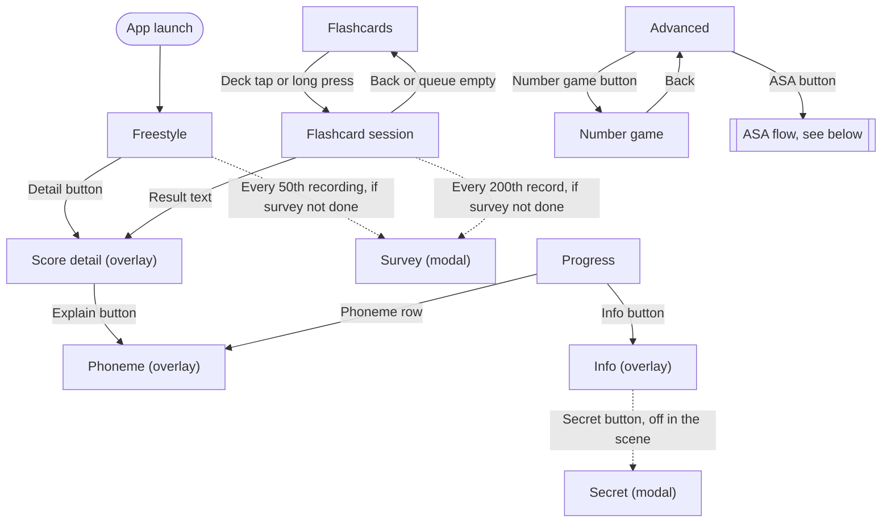
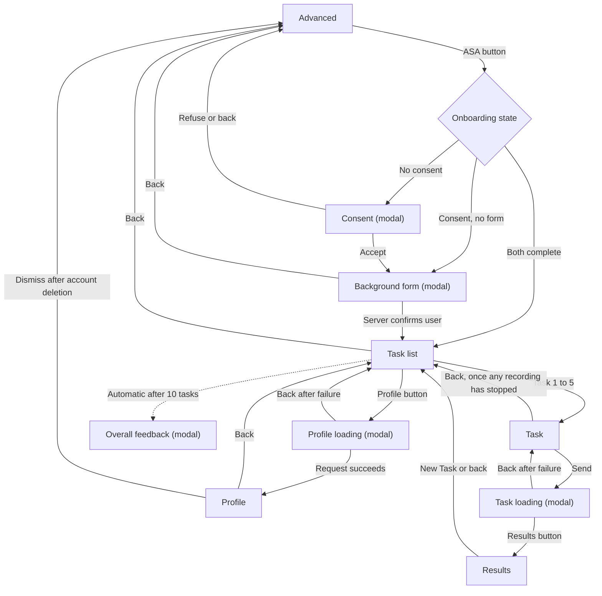

# Screens

Every screen and modal in the app, and how they connect.

## Screens and overlays

| Class                    | Layer           | Purpose                       |
| ------------------------ | --------------- | ----------------------------- |
| `FreestyleScreen`        | Tab root        | Freestyle pronunciation       |
| `FlashcardsScreen`       | Tab root        | Flashcard deck list           |
| `AdvancedScreen`         | Tab root        | Advanced home                 |
| `ProgressScreen`         | Tab root        | Phoneme progress              |
| `FlashcardSessionScreen` | Screen          | A flashcard session           |
| `NumberGameScreen`       | Screen          | Number game                   |
| `ASATaskListScreen`      | Screen          | ASA task list                 |
| `ASATaskScreen`          | Screen          | One ASA speaking task         |
| `ASAResultsScreen`       | Screen          | ASA feedback for a task       |
| `ASAProfileScreen`       | Screen          | ASA level and account         |
| `ScoreDetailScreen`      | Overlay         | Per-word pronunciation detail |
| `PhonemeScreen`          | Overlay         | Explanation of one phoneme    |
| `InfoScreen`             | Overlay         | About the app                 |

## Modals

| Modal                 | Class                  | Opened from        | Back                       |
| --------------------- | ---------------------- | ------------------ | -------------------------- |
| Instruction           | `InstructionModal`     | Any tab or Phoneme | Closes, not marked as seen |
| Survey                | `SurveyModal`          | Recording count    | Closes                     |
| Secret                | `SecretModal`          | Info               | Closes                     |
| Consent               | `ModalScreen.Attach`   | Advanced           | Same as Refuse             |
| Background form       | `ModalScreen.Attach`   | Advanced           | Closes, blocked while sending |
| Task loading          | `TaskSendingModal`     | Task               | Blocked until an error     |
| Profile loading       | `LoadingModal`         | Task list, profile | Blocked until an error     |
| Overall feedback      | `ModalScreen.Attach`   | Task list          | Closes, counts as declining |
| Results info          | `ModalScreen.Attach`   | Results            | Closes                     |
| Results dimension     | `ModalScreen.Attach`   | Results            | Closes                     |
| Results feedback      | `ModalScreen.Attach`   | Results            | Closes                     |
| Profile settings      | `ModalScreen.Attach`   | Profile            | Closes                     |
| Delete confirmation   | `ModalScreen.Attach`   | Settings           | Closes, blocked while deleting. After deleting, closes to Advanced |
| Profile feedback      | `ModalScreen.Attach`   | Profile            | Closes                     |

Back leaves an instruction unmarked, as closing one by navigation does today, so it shows
again on the next visit. Only OK marks it as seen.

## Tabs and general screens

Any tab can be selected from any screen on the `Screen` layer. Overlays and modals cover
the tab bar, so they must be closed first.

Back from an overlay or modal returns to whatever opened it, so those arrows are omitted.

## ASA flow

Consent missing with the form marked complete has no branch, so the ASA button does nothing in
that state. This matches the old code.

## Navigator calls

| Situation                  | Call                                                      |
| -------------------------- | --------------------------------------------------------- |
| Tab button                 | `SelectTab(tabRoot)`                                      |
| Open a deck                | `Push<FlashcardSessionScreen>()`                          |
| Session queue empty        | `PopTo<FlashcardsScreen>()`                               |
| Open a task                | `Push<ASATaskScreen>().DisplayTask(task)`                 |
| Open results               | `Push<ASAResultsScreen>()`                                |
| New Task                   | `PopTo<ASATaskListScreen>()`                              |
| Back on results            | `HandleBack` calls `PopTo<ASATaskListScreen>()`           |
| Profile request succeeds   | `Back()` closes the loading popup, then `Push<ASAProfileScreen>()` and `ShowStats` |
| Account deleted            | `PopToRoot()`                                             |
| Survey due                 | `Open<SurveyModal>()`                                     |
