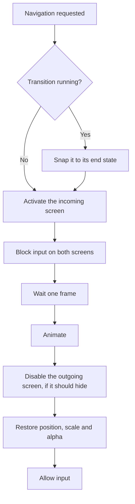

# Screen Transitions

How navigation is animated. The animations use coroutines, with no extra package.

## Animations

| Navigation               | Animation                                                         | Duration |
| ------------------------ | ----------------------------------------------------------------- | -------- |
| Push a screen            | New screen slides in from the right while the old one slides left | 250 ms   |
| Back from a screen       | The reverse                                                       | 250 ms   |
| Change tab               | Crossfade                                                         | 150 ms   |
| Open or close an overlay | Slides up from the bottom, or back down                           | 250 ms   |
| Open or close a modal    | Modal fades and scales from 95%, and the dim fades                | 200 ms   |
| App launch or quit       | None                                                              | –        |

Durations are constants in `ScreenTransitions`, and 0 makes a transition instant. All
animations use unscaled time and an ease-out curve. They change a screen's `CanvasGroup`
and root `RectTransform`.

`Navigator` runs screen and overlay animations and `ModalHost` runs modal ones. Both stay
active, so an animation survives its screen being disabled.

## Lifecycle of a transition

## Rules

- **Data:** the incoming screen activates immediately, so
  `Push<T>().DisplayTask(...)` still works.
- **Hiding:** the outgoing screen is disabled when the animation ends, so its `OnDisable`
  runs up to 250 ms after navigation starts.
- **Input:** both screens have `blocksRaycasts` off during the animation. A modal only blocks
  itself, because the dim beneath it already covers everything else.
- **Interruptions:** any new navigation first snaps the running transition to its end
  state, then proceeds. This covers rapid taps, back presses and network callbacks.
- **Multi-layer pops:** `PopTo`, `PopToRoot` and `SelectTab` animate only the top entry
  and the destination, and hide everything between them instantly.
- **Heavy screens:** the animation starts one frame after activation, so a screen that
  builds rows in `OnEnable` does not skip the start of the animation.
- **End state:** position, scale and alpha are always restored when a transition finishes.

## Canvases

`AppScreen` adds a nested `Canvas` and `GraphicRaycaster` to its root from code, so
animating one screen does not rebuild the others. A nested Canvas without a
`GraphicRaycaster` would stop its buttons working.

## Conflicts with other animation

An `Animator` or legacy `Animation` that writes to a screen's root overrides the
transition. If a screen animates its root, move the animated content into a child object.
Animating children inside a screen is fine.

`ScoreDetailScreen` and `PhonemeScreen` have these components on their roots, but no clip in
the project writes to a screen root, so they do not conflict.
